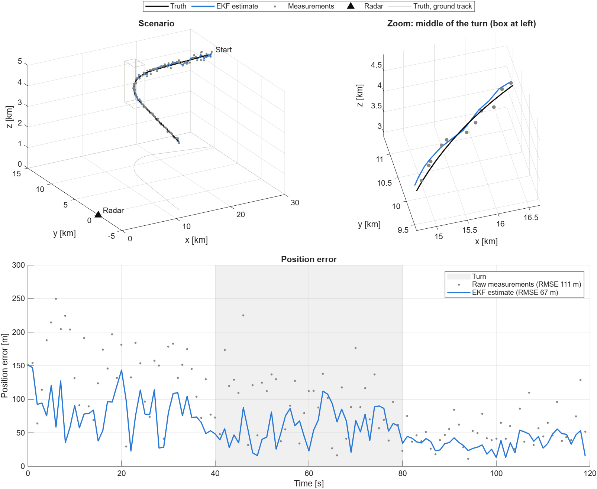
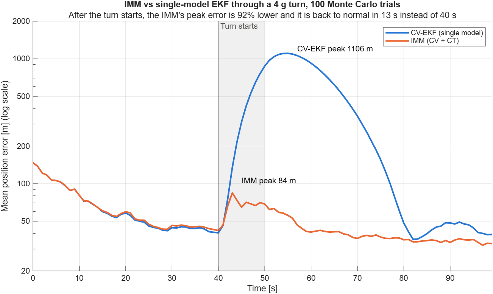
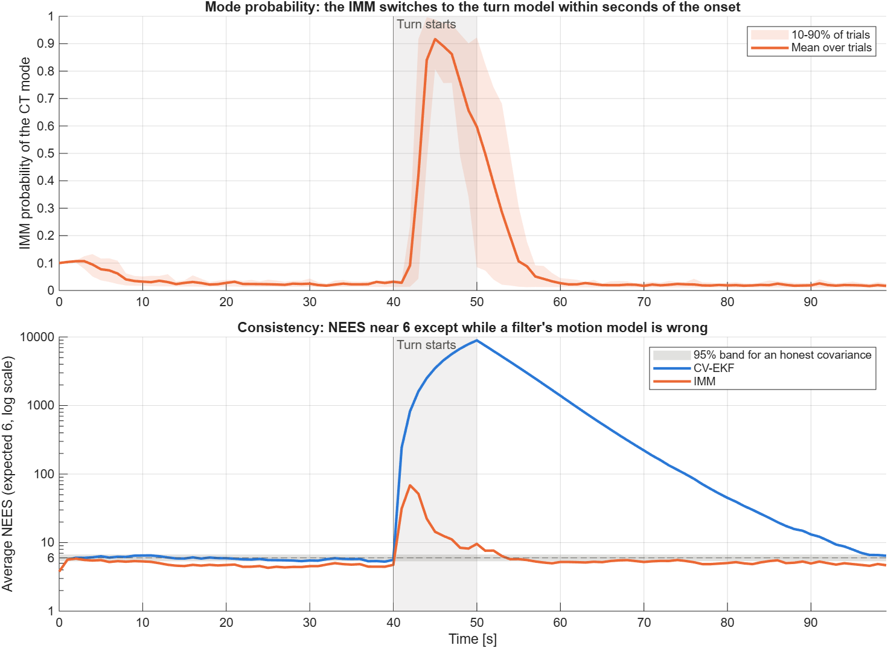

# Radar Target Tracking for Missile Defense

A ground radar sees an incoming air target only as noisy range, azimuth and elevation measurements, and the target can maneuver at any moment. A defense system still has to know where the target is and where it is heading, accurately and in real time. This project builds that tracking pipeline step by step in MATLAB: it simulates target trajectories and radar measurements, estimates the target's 3D position and velocity with nonlinear Kalman filtering, and checks each piece against known answers. Day 1 is the baseline: an extended Kalman filter (EKF) with a nearly-constant-velocity motion model, tracking a target that flies straight, makes a coordinated turn, then flies straight again. Day 2 adds an interacting multiple model (IMM) filter that runs a straight-flight model and a turning model side by side, and shows in a Monte Carlo study that it recovers from a hard maneuver far faster than the single-model EKF.

## Day 1: EKF tracking from radar measurements



*Top: the scenario, and a zoom on the turn. The EKF estimate (blue) follows the truth (black) and smooths out the scatter of the raw measurements (gray). Bottom: position error over time. The constant-velocity model lags behind the target during the turn (shaded).*

## Day 2: an IMM recovers from a maneuver much faster than a single-model EKF



A single-model EKF has to commit to one motion model. Tuned for straight flight, it trusts that model so much that a sudden 4 g turn throws it off by more than a kilometre. The IMM runs a constant-velocity (CV) and a coordinated-turn (CT) EKF side by side. Every step it mixes their estimates according to how likely the target is to have switched between straight flight and turning, and it weights each model by how well it predicted the latest measurement.

The study runs 100 Monte Carlo trials of one scenario: straight flight, a 4 g, 90° turn from t = 40 s to 50 s, then straight again. Every trial draws fresh measurement noise and fresh 0.1 g random accelerations of the target. The CV-EKF is the IMM's CV mode on its own, so before the turn the two filters face exactly the same problem.

- **Peak error after the turn starts: 92% lower** with the IMM (84 m vs 1,106 m).
- **Back to normal in 13 s instead of 40 s**, 68% faster. "Normal" means within 25% of the filter's own error before the turn.
- **No cost in straight flight:** before the turn the IMM's mean error is 47.4 m and the CV-EKF's 46.0 m (+3%).
- **Benchmark against the industry tool:** `toolboxImm` builds the same filter from the Sensor Fusion and Tracking Toolbox: `trackingIMM` with two `trackingEKF` filters using the toolbox's `constvel` and `constturn` models. Over all 100 trials its estimates agree with this repo's `immFilter` to within 4e-6 m.



*Top: the IMM's probability of the turn model passes 0.5 four seconds after the turn starts and drops back once the turn ends. Bottom: the normalized estimation error squared (NEES), averaged over the trials. It is 6 for a filter whose covariance is honest about its error. The CV-EKF sits at 5.6 before the turn, then runs into the thousands: during the turn its covariance claims an accuracy it no longer has. The IMM is slightly conservative in straight flight (about 4.6 to 5, because the turn model's uncertainty about the turn rate widens the mixture) and overconfident only during the first few seconds of the maneuver.*

## How to run

Developed on MATLAB R2026b; it should run on R2023a or newer. Everything runs on base MATLAB except the Day 2 benchmark against `trackingIMM`, which needs the Sensor Fusion and Tracking Toolbox; without it, the benchmark is skipped.

From the repository root:

```matlab
runtests("tests")                      % unit and acceptance tests
run("experiments/exp01_ekf_track.m")   % Day 1: simulate, track, save figures/exp01_ekf_track.png
run("experiments/exp02_imm_vs_ekf.m")  % Day 2: 100-trial Monte Carlo, saves figures/exp02_*.png
```

## What the tests check

- The analytic measurement Jacobian matches central finite differences to a relative 1e-6.
- With noise-free measurements of a constant-velocity target, the EKF locks onto the truth to numerical precision after a short burn-in.
- On the maneuvering scenario, the EKF position RMSE is well below the error of the raw measurements.
- The coordinated turn is an exact circular arc, the measurement angles follow the documented conventions, and azimuth innovations are wrapped across ±π.
- The CT motion model reproduces the simulated turn exactly, and its Jacobian, including the turn-rate column at and near zero turn rate, matches finite differences.
- With the turn mode switched off, the IMM reduces exactly to the CV-EKF.
- Day 2 acceptance, over 50 Monte Carlo trials: the IMM costs no accuracy before the maneuver, its turn-mode probability passes 0.5 within 6 s of the onset, its peak error after the onset is far below the CV-EKF's, and its NEES stays near the expected value away from the maneuver.
- The IMM matches the toolbox's `trackingIMM` to within 1 mm (skipped without the toolbox).

## Layout

| Path | Contents |
|---|---|
| `src/` | scenario simulation, radar measurement model and Jacobian, CV and CT motion models, EKF, IMM, toolbox benchmark |
| `experiments/` | one script per experiment; each saves its figures to `figures/` |
| `tests/` | `matlab.unittest` test classes |

Conventions: the state is `x = [px; py; pz; vx; vy; vz]` (m, m/s) in a Cartesian frame with z up. The CT model adds the turn rate `omega` (rad/s, positive counter-clockwise seen from above) as a seventh state. A measurement is `[range; azimuth; elevation]`, with azimuth measured in the x-y plane from +x toward +y and elevation measured up from that plane.
